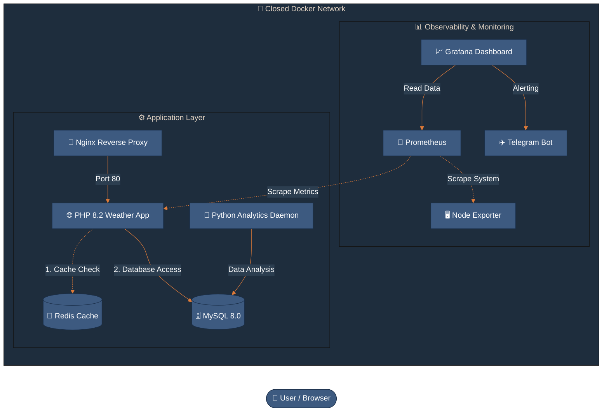

# 🌤️ Weather Analytics Platform - Full DevOps Stack

## 🏗️ Project Architecture & Stack

This platform collects and analyzes weather data in real time. The architecture consists of a user-facing PHP frontend application and a Python background microservice responsible for analyzing the data stored in a MySQL database.

The main goal of this project is to demonstrate a complete DevOps lifecycle — from local development in a Docker environment, through an automated CI/CD pipeline, all the way to production deployment on an AWS EC2 instance with an integrated monitoring and alerting system.

### Project Architecture Diagram

### Technologies Used

* **Reverse Proxy & SSL:** Nginx (Reverse Proxy, SSL Termination via Certbot/Let's Encrypt).
* **Frontend Application:** PHP 8.2 + Apache (Containerized, Multi-stage build).
* **Caching Layer:** Redis (In-memory data store for lower API calls).
* **Backend Worker:** Python 3.9 (Unbuffered analytics daemon).
* **Database:** MySQL 8.0 (Internal network access only).
* **Monitoring & Observability:** Prometheus (Metrics collection), Grafana (Visualization).
* **Alerting:** Telegram API integration.
* **CI/CD & Deployment:** GitHub Actions (Automated build & deploy to AWS).

---

## 📈 Observability & Alerting (Monitoring)

A full **observability stack** is implemented to monitor the vital parameters of the server and the application.

* **Scraper (Prometheus):** Collects metrics (CPU usage, RAM usage, disk space, network traffic, container status) from the AWS EC2 instance.
* **Visualization (Grafana):** The Grafana dashboard (http://13.53.32.202:3000) displays metrics in real time, enabling fast diagnosis of server load.
* **Alerting logic:** Grafana alert rules are configured to watch the metrics. For example, when CPU usage goes above **X%** and stays at that level for more than a minute, the system reacts automatically.
* **Notifications (Telegram API):** A custom **Telegram bot** is integrated. As soon as an alert fires, the bot sends a formatted message to my phone in real time.

---

## 🔄 CI/CD Pipeline & Automatic Deployment

I use **GitHub Actions** to automate the deployment process.

1.  **Code Push:** Every `git push` to the `main` branch triggers the pipeline.
2.  **Build Stage:** The pipeline runs automated tests, validates the PHP code, and builds new Docker images for the Frontend and Analytics services.
3.  **Deploy Stage:** Using SSH, the pipeline connects to the AWS EC2 instance (13.53.32.202), pulls the latest Docker images, and performs a safe **blue/green deployment** (or similar *rolling update*) of the containers with zero downtime.

---

## 🚀 Deployment Guide

### ☁️ 1. Production (AWS EC2 Deployment)

In production I use the main `docker-compose.yml`. The focus here is on security and performance. The application code is "baked" into the image, and Nginx listens on ports 80 and 443.

**command:** `docker-compose up -d`

| Service | URL | Note |
| :--- | :--- | :--- |
| **Application** | [https://13.53.32.202.nip.io/](https://13.53.32.202.nip.io/) | Ports 80, 443 |
| **Grafana** | [http://13.53.32.202:3000](http://13.53.32.202:3000) | Monitoring dashboard |
| **Prometheus** | [http://13.53.32.202:9090](http://13.53.32.202:9090) | Raw metrics data |
| **Db production** | [http://13.53.32.202.nip.io:8080/](http://13.53.32.202.nip.io:8080/) | phpMyAdmin: locked to my IP address only |

### 🛠️ Maintenance

#### SSL Certificate Renewal (Lock)

Certificates expire every 90 days. To renew them manually, I use the following procedure:
1.  Stop Nginx (to free up port 80): `docker-compose stop nginx`
2.  Run Certbot: `docker run --rm -p 80:80 -v /etc/letsencrypt:/etc/letsencrypt certbot/certbot renew --standalone`
3.  Start Nginx: `docker-compose start nginx`

🔄 **Automatic Renewal (Cronjob)**
Automation is set up to do this on the 1st of every month at 03:00 AM.
Check with: `crontab -l`

🛡️ **Security Best Practices Implemented in the Project**
* **CVE Patching:** Every build automatically pulls the latest patches for libssl3 and openssl to prevent known exploits.
* **Internal Networking:** Only Nginx communicates with the outside world. The database and Analytics service are hidden inside the Docker network and have no public ports.
* **Health Checks:** The application does not start until the MySQL database confirms it is fully ready to accept queries.

---

## 🛠️ Maintenance Bash Commands

Using aliases defined in `~/.bashrc`, I have quick access to key DevOps tasks.

| Alias | Command | Description |
| :--- | :--- | :--- |
| **stats** | `~/server-stats.sh` | Shows current CPU, RAM, and disk usage. Used to check server load. |
| **alog** | `docker logs -f --tail 0` | Follows the Python analytics live. Shows new reports as soon as analytics.py generates them. |
| **dashboard** | N/A | Combined view. First prints system stats, then the last 15 lines of analytics. Ideal for a quick "health check" of the whole system. |
| **server** | `~/manager.py` | Custom Python manager for controlling containers and application status. |

---

## 💻 2. Local Development

For development on my own machine I use `docker-compose.local.yml`. This file enables Hot-Reload (code changes appear immediately without restarting the container) via volume mounts.

**command:** `docker-compose -f docker-compose.local.yml up --build`

| Service | URL |
| :--- | :--- |
| **App URL** | [http://localhost:8080](http://localhost:8080) |
| **phpMyAdmin** | [http://localhost:8081](http://localhost:8081) |
| **Grafana** | [http://localhost:3000](http://localhost:3000) |
| **Prometheus** | [http://localhost:9090](http://localhost:9090) |
