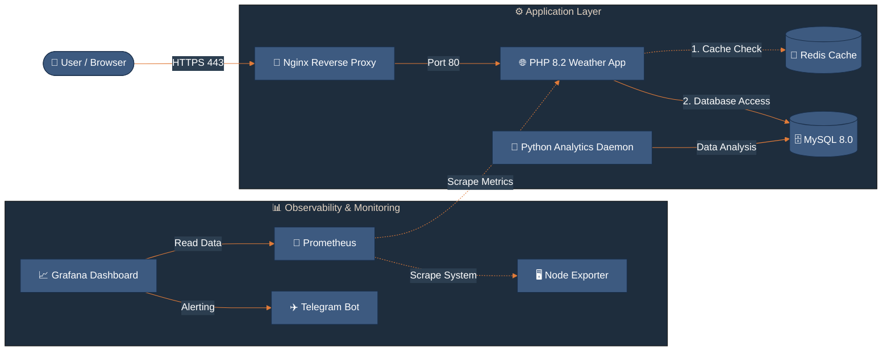

🌤️ Weather Analytics Platform - Full DevOps Stack

## 🏗️ Project Architecture & Stack

Ova platforma služi za prikupljanje i analizu vremenskih podataka u realnom vremenu. Sastoji se od PHP frontend aplikacije za korisnike i Python pozadinskog mikroservisa koji vrši analitiku podataka unutar MySQL baze.

Cilj projekta je demostracija kompletnog DevOps životnog ciklusa — od lokalnog razvoja u Docker-u, preko automatizovanog CI/CD pajplajna, do produkcije na AWS EC2 instanci sa punim monitoringom i alarmingom.

### Project Architecture Diagram

### Technologies Used

* **Reverse Proxy & SSL:** Nginx (Reverse Proxy, SSL Termination via Certbot/Let's Encrypt).
* **Frontend Application:** PHP 8.2 + Apache (Containerized, Multi-stage build).
* **Caching Layer:** Redis (In-memory data store for lower API calls).
* **Backend Worker:** Python 3.9 (Unbuffered analytics daemon).
* **Database:** MySQL 8.0 (Internal network access only).
* **Monitoring & Observability:** Prometheus (Metrics collection), Grafana (Visualization).
* **Alerting:** Telegram API integration.
* **CI/CD & Deployment:** GitHub Actions (Automated build & deploy to AWS).

---

## 📈 Observability & Alerting (Monitoring)

Implementirali smo pun **observability stack** koji nadgleda vitalne parametre servera i aplikacije.

* **Scraper (Prometheus):** Skuplja metrike (CPU usage, RAM usage, Disk space, Network traffic, Container status) sa AWS EC2 instance.
* **Visualization (Grafana):** Grafana dashboard (http://13.53.32.202:3000) prikazuje metrike u realnom vremenu, omogućavajući brzu dijagnostiku opterećenja servera.
* **Alerting logic:** Podesili smo Grafana Alert pravila koja prate metrike. Na primer, kada CPU zauzeće pređe **40%** i ostane na tom nivou duže od jednog minuta, sistem automatski reaguje.
* **Notifications (Telegram API):** Integrisali smo prilagođenog **Telegram botića**. Čim alert pukne, botić šalje formatiranu poruku u realnom vremenu na moj telefon.

---

## 🔄 CI/CD Pipeline & Automatic Deployment

Koristimo **GitHub Actions** za automatizaciju deployment procesa.

1.  **Code Push:** Svaki `git push` na `main` granu aktivira pipeline.
2.  **Build Stage:** Pipeline pokreće automatizovane testove, validira PHP kod, i gradi nove Docker slike (images) za Frontend i Analytics servise.
3.  **Deploy Stage:** Koristeći SSH, pipeline se povezuje na AWS EC2 instancu (13.53.32.202), povlači najnovije Docker slike, i radi bezbedan **blue/green deployment** (ili sličan *rolling update*) kontejnera bez prekida rada aplikacije.

---

## 🚀 Deployment Guide

### ☁️ 1. Produkcija (AWS EC2 Deployment)

U produkciji koristimo glavni `docker-compose.yml`. Ovde je fokus na sigurnosti i performansama. Kod aplikacije je "zapečen" (baked) u sliku, a Nginx sluša na portovima 80 i 443.

**komanda:** `docker-compose up -d`

| Service | URL | Note |
| :--- | :--- | :--- |
| **Aplikacija** | [https://13.53.32.202.nip.io/](https://13.53.32.202.nip.io/) | Port 80, 443 |
| **Grafana** | [http://13.53.32.202:3000](http://13.53.32.202:3000) | Dashboard za monitoring |
| **Prometheus** | [http://13.53.32.202:9090](http://13.53.32.202:9090) | Čisti metrics podaci |
| **Db production** | http://13.53.32.202.nip.io:8080/ | phpMyAdmin: Zaključan samo za moju IP adresu |

### 🛠️ Maintenance (Održavanje)

#### Obnova SSL Sertifikata (Katanac)

Sertifikati ističu svakih 90 dana. Da bi ih obnovio ručno, koristi se sledeća procedura:
1.  Stopiraj Nginx (da oslobodiš port 80): `docker-compose stop nginx`
2.  Docker run --rm -p 80:80 -v /etc/letsencrypt:/etc/letsencrypt certbot/certbot renew --standalone -> pokretanje Certbot-a.
3.  Pokreni Nginx: `docker-compose start nginx`

🔄 **Automatsko ažuriranje (Cronjob)**
Podesili smo automatizaciju koja ovo radi svakog 1. u mesecu u 03:00h ujutru.
Komanda za proveru: `crontab -l`

🛡️ **Security Best Practices Implementirane u projektu**
* **CVE Patching:** Svaki build automatski povlači najnovije zakrpe za libssl3 i openssl kako bi se sprečili poznati exploiti.
* **Internal Networking:** Samo Nginx komunicira sa spoljnim svetom. Baza i Analytics servis su sakriveni unutar Docker mreže i nemaju javne portove.
* **Healthy Checks:** Aplikacija ne kreće sa radom dok MySQL baza ne potvrdi da je potpuno spremna za upite.

---

## 🛠️ Maintenance Bash Commands

Korišćenjem aliase-a definisanih u `~/.bashrc`, imamo brzi pristup ključnim DevOps zadacima.

| Alias | Command | Description |
| :--- | :--- | :--- |
| **stats** | `~/server-stats.sh` | Prikazuje trenutno zauzeće CPU, RAM memorije i disk prostora. Koristiti za proveru opterećenja servera. |
| **alog** | `docker logs -f --tail 0` | Prati Python analitiku uživo. Prikazuje nove izveštaje čim ih analytics.py generiše. |
| **dashboard** | N/A | Kombinovani prikaz. Prvo ispisuje sistemske statistike, a zatim poslednjih 15 redova analitike. Idealno za brzi "health check" celog sistema. |
| **server** | `~/manager.py` | Naš prilagođeni Python menadžer za kontrolu kontejnera i statusa aplikacije. |

---

## 💻 2. Lokalni Razvoj (Local Development)

Za razvoj na tvom kompjuteru koristimo `docker-compose.local.yml`. Ovaj fajl omogućava Hot-Reload (promene u kodu se odmah vide bez restartovanja kontejnera) preko volumen mount-ovanja.

**komanda:** `docker-compose -f docker-compose.local.yml up --build`

| Service | URL |
| :--- | :--- |
| **App URL** | [http://localhost:8080](http://localhost:8080) |
| **phpMyAdmin** | [http://localhost:8081](http://localhost:8081) |
| **Grafana** | [http://localhost:3000](http://localhost:3000) |
| **Prometheus** | [http://localhost:9090](http://localhost:9090) |   